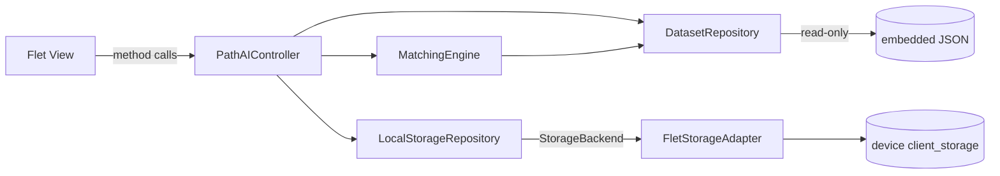

# Path.AI — Architecture & Collaboration Guide

Path.AI is an **offline** program-recommendation prototype for SHS students in Camarines Sur.
One Python codebase (Flet) ships as an Android APK + Windows demo. **No server, no HTTP,
no Supabase, no accounts.** All data lives on-device.

The app follows **MVC** with an **internal Python API** — the Controller is the only
bridge between the UI and the data/logic layers.

---

## 1. Who owns what

| Layer | Files | Owner | May import `flet`? |
|---|---|---|---|
| **View** | `main.py`, `app/view/**` | Frontend team | ✅ Yes (only here) |
| **Controller (internal API)** | `app/controller/pathai_controller.py` | Backend (DB/API/MVC) | ❌ Never |
| **Model** | `app/model/**` | Backend (DB/API/MVC) | ❌ Never |
| **Data ("database")** | `app/data/*.json` | Backend (DB/API/MVC) | — |

> "API" in this project means **in-process Python method calls on `PathAIController`**,
> not REST endpoints. There is no network layer at runtime.

---

## 2. File map — which file do I touch?

```
repo/
├── main.py                        # VIEW: Flet entry point, routing, page setup
├── app/
│   ├── view/                      # VIEW: pages, widgets, FletStorageAdapter
│   │   └── flet_storage_adapter.py# VIEW: the ONLY bridge to device storage
│   ├── controller/
│   │   └── pathai_controller.py   # API: all UI calls go here — do not bypass
│   ├── model/
│   │   ├── entities.py            # Dataclasses: HEI, Program, TraitProfile, etc.
│   │   ├── dataset_repository.py  # Reads embedded JSON (read-only)
│   │   ├── storage_repository.py  # User data + 30-day purge + clear
│   │   └── matching_engine.py     # Scoring/ranking (rule-based; ML swap in Week 7)
│   └── data/
│       ├── heis.json              # Reference DB: 5 HEIs (SAMPLE — unverified)
│       └── programs.json          # Reference DB: 16 programs (SAMPLE — unverified)
├── smoke_test.py                  # Backend test harness (runs without Flet)
├── requirements.txt               # flet[all]==0.28.3  (PINNED — see §7)
└── ARCHITECTURE.md
```

**Frontend rule of thumb:** if you need data or an action, call a `controller` method.
Never import `app.model.*` from View code, and never read the JSON files directly.

---

## 3. Data flow



---

## 4. Internal API reference (`PathAIController`)

Construct once at app start:

```python
controller = PathAIController(FletStorageAdapter(page))
```

| Method | Args | Returns | Use it when… |
|---|---|---|---|
| `trait_catalog()` | — | `[{key, label, hint}]` | Building Layer 1 sliders |
| `locations()` | — | `["Goa", "Nabua", …]` | Building the location dropdown |
| `has_saved()` | — | `bool` | Showing "Resume" on the welcome screen |
| `auto_purged` *(attr)* | — | `bool` | Showing the 30-day auto-delete notice |
| `answers()` | — | `dict` (shape below) | Re-rendering a resumed intake |
| `last_results()` | — | `list[payload]` | Showing saved results on resume |
| `set_trait(key, value)` | trait key, int 1–5 | — | A slider changes |
| `set_preferences(**kw)` | `budget_cap`, `location`, `willing_to_relocate`, `scholarship_need` | — | A Layer 2 preference control changes |
| `set_profile(**kw)` | `strand`, `grade_band`, `gender` | — | Optional profile fields change |
| `set_step(n)` | `1` or `2` | — | Next / Back between intake layers |
| `submit()` | — | `list[payload]` (top 3) | "Get recommendations" pressed |
| `clear_my_data()` | — | — | User confirms "Clear my data" |

Every `set_*` call **persists immediately** — the View does not manage saving.

### `answers()` shape
```json
{
  "traits": {"values": {"analytical": 3, "technical": 5, "...": 3}},
  "preferences": {"budget_cap": 20000, "location": "Nabua",
                  "willing_to_relocate": false, "scholarship_need": true},
  "profile": {"strand": "STEM", "grade_band": "85-89", "gender": "Prefer not to say"},
  "step": 2
}
```

### Result payload shape (from `submit()` / `last_results()`)
```json
{
  "program": {"id": "bsit", "name": "BS Information Technology",
              "trait_weights": {"technical": 3}, "hei_ids": ["cspc", "adnu"]},
  "match_pct": 86,
  "rank_score": 0.91,
  "badges": ["Within budget", "Preferred location"],
  "rationale": "Your technical and analytical interests line up with…",
  "heis": [{"name": "Camarines Sur Polytechnic Colleges", "municipality": "Nabua",
            "type": "SUC", "est_annual_tuition_php": 0, "scholarships": true,
            "tuition_note": "SUC: free tuition for eligible students (RA 10931)…"}]
}
```
Display **`match_pct`** as the fit bar. `rank_score` (fit + preference bonuses) is for
sorting only — don't show it. Render `badges` as chips and `heis` as the "Offered at" list.

---

## 5. UI event → API cheat sheet

| UI event | Call |
|---|---|
| App launch | build controller → read `auto_purged`, `has_saved()`, `last_results()` |
| Layer 1 slider moved | `set_trait(key, int(value))` |
| Budget / location / relocate / scholarship changed | `set_preferences(field=value)` |
| Strand / grade band / gender changed | `set_profile(field=value)` |
| Next / Back | `set_step(2)` / `set_step(1)` |
| "Get recommendations" | `submit()` → navigate to results |
| "Resume" | `answers()` + `last_results()` |
| "Clear my data" (after confirm dialog) | `clear_my_data()` → navigate home |

---

## 6. Storage contract

User data lives in device key-value storage under the `pathai.` namespace:

| Key | Content | Lifecycle |
|---|---|---|
| `pathai.answers` | intake state (JSON string) | until cleared / 30-day purge |
| `pathai.results` | last top-3 payloads (JSON string) | until cleared / 30-day purge |
| `pathai.last_active` | epoch seconds | refreshed on every save/load |

The Model defines a `StorageBackend` protocol (`get / set / remove / keys`).
**The View team implements it once** — this is the only Flet code the backend needs:

```python
# app/view/flet_storage_adapter.py  (VIEW TEAM)
class FletStorageAdapter:
    def __init__(self, page): self._s = page.client_storage
    def get(self, key): return self._s.get(key)
    def set(self, key, value): self._s.set(key, value)
    def remove(self, key): self._s.remove(key)
    def keys(self, prefix): return self._s.get_keys(prefix)
```

Purge (30 days inactivity) and "Clear my data" are handled **inside the Controller** —
the View just calls the methods and shows the notices.

---

## 7. Hard rules (do not break these)

1. **Offline only.** No `requests`, no HTTP clients, no Supabase, no analytics.
   The only network event in the project is the one-time APK download (GitHub Releases).
2. **View → Controller only.** No `app.model.*` imports in View code.
3. **No `flet` imports** in `app/model/**` or `app/controller/**`.
4. **Privacy:** no names/contact fields. `gender`, `strand`, `grade_band` are stored
   but **never** reach the matching engine — `submit()` enforces this. Don't "fix" it.
5. **JSON is read-only at runtime.** Dataset corrections happen via commits to
   `app/data/*.json` (Weeks 3–4 data compilation), never from app code.
6. **Flet is pinned to `0.28.3`** (`requirements.txt`). If we upgrade, only
   `FletStorageAdapter` should need changes — raise it with the backend owner first.

---

## 8. Scoring (for UI copy & the paper)

- Student traits: 1–5 per trait (6 traits). Program weights: 0–3.
- `match_pct` = normalized weighted trait fit (pure interest/strength match).
- Ranking adds soft preference bonuses: +5% within budget, +5% preferred location,
  −3% location mismatch when unwilling to relocate, +3% scholarships when needed.
- Rationale text is template-generated from the student's strongest matching traits.

---

## 9. Run & test

```bash
# everyone
pip install -r requirements.txt

# frontend: run the app
flet run main.py

# backend: test Model + Controller WITHOUT Flet
python smoke_test.py
```

Builds (Week 8–9): `flet build windows`, `flet build apk` (APK needs Flutter SDK).

---

## 10. Planned extension (Week 7)

`MatchingEngine` is a strategy interface. The trained decision tree will be exported
as `app/data/model_rules.json` and loaded by a new `JsonDecisionTreeEngine`.
**One line changes in the Controller; the View and this API contract stay identical.**