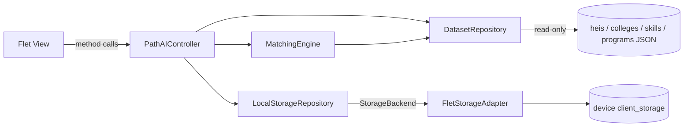

# Path.AI — Architecture & Collaboration Guide

Path.AI is an **offline** program-recommendation prototype for graduating SHS students in
Camarines Sur. One Python codebase (Flet) ships as an Android APK + Windows demo.
**No server, no HTTP, no Supabase, no accounts.** All data lives on-device.

The app follows **MVC** with an **internal Python API** — `PathAIController` is the only
bridge between the UI and the data/logic layers. Recommendations are **hierarchical**:
traits pick an academic field, then skills rank programs inside that field.

---

## 1. Who owns what

| Layer / Area | Files | Owner (role) | May import `flet`? |
|---|---|---|---|
| **View** | `main.py`, `app/view/**` | Requirements Engineer & UI/UX Lead | ✅ Yes (only here) |
| **Controller (internal API)** | `app/controller/pathai_controller.py` | Data & Systems Architect | ❌ Never |
| **Model** | `app/model/**` | Data & Systems Architect | ❌ Never |
| **Data ("database")** | `app/data/*.json` | Data & Systems Architect | — |
| **UML (class + sequence), SRS data dictionary** | `docs/**` | Data & Systems Architect | — |
| **GitFlow, automated tests, packaging/releases** | CI config, build scripts | QA & DevOps Lead | — |
| **Scope, SRS, user stories** | `docs/**` | Requirements Engineer & UI/UX Lead | — |

> Fill in member names before committing. "API" here means **in-process Python method
> calls on `PathAIController`**, not REST endpoints. There is no network layer at runtime.

---

## 2. File map — which file do I touch?

```
repo/
├── main.py                        # VIEW: Flet entry point, routing, page setup
├── app/
│   ├── view/                      # VIEW: pages, widgets, FletStorageAdapter
│   │   └── flet_storage_adapter.py# VIEW: the ONLY bridge to device storage
│   ├── controller/
│   │   └── pathai_controller.py   # API: all UI calls go here — do not bypass
│   ├── model/
│   │   ├── entities.py            # HEI, College, Program, Skill, TraitProfile,
│   │   │                          # SkillProfile, Preferences, StudentProfile,
│   │   │                          # IntakeAnswers, Recommendation
│   │   ├── dataset_repository.py  # Reads embedded JSON (read-only)
│   │   ├── storage_repository.py  # User data + 30-day purge + clear
│   │   └── matching_engine.py     # Two-stage scoring (rule-based; ML swap Week 7)
│   └── data/
│       ├── heis.json              # 12 institutions
│       ├── colleges.json          # 13 academic clusters  (Layer 2 targets)
│       ├── skills.json            # 57 skill items        (Layer 3 catalog)
│       └── programs.json          # 87 programs + college_id + skill_weights
├── smoke_test.py                  # Model/Controller test (runs without Flet)
├── validate_dataset.py            # JSON referential-integrity check
├── requirements.txt               # flet[all]==0.28.3  (PINNED — see §11)
└── ARCHITECTURE.md
```

**Frontend rule of thumb:** if you need data or an action, call a `controller` method.
Never import `app.model.*` from View code, and never read the JSON files directly.

---

## 3. Data flow



---

## 4. The three intake layers

| Layer | Collects | Items | Reaches the engine? |
|---|---|---|---|
| **1 — Prefs / Profile** | `prefers_tuition_free`, `location`, `willing_to_relocate`, `scholarship_need` · `strand`, `grade_band`, `gender` | ~7, **all optional + skippable** | Only the 4 prefs (soft boosts). Strand / grade / gender **never** |
| **2 — College/Department Traits** | Six-trait battery, 1–5 each: analytical, creative, technical, people, organizational, entrepreneurial | 6 sliders | ✅ Ranks the 13 clusters → gates to top 3 |
| **3 — Specific Program Skills** | Skill statements scoped to the student's top clusters | ≤12 (adaptive) | ✅ Ranks programs **within** those clusters |

**Screen flow:**
`L1 prefs/profile → L2 six sliders → top_colleges() → skill_catalog() → L3 sliders → submit()`

- **Layer 2 → Layer 3 is adaptive.** `skill_catalog()` defaults to the **top 2** clusters
  (≤12 items) while the candidate gate stays at **top 3**. Programs in cluster #3 fall back
  to trait-based scoring automatically.
- ⚠️ **Re-fetch Layer 3 whenever Layer 2 changes.** If a student goes back and moves a
  slider, call `skill_catalog()` again. Stale skill answers are harmless — they're ignored
  by the gate.
- **Layer 1 must never block progress.** Provide a "Skip" path; the engine works with
  defaults.

---

## 5. Internal API reference (`PathAIController`)

Construct once at app start:

```python
controller = PathAIController(FletStorageAdapter(page))
```

### Queries

| Method | Returns | Use it when… |
|---|---|---|
| `trait_catalog()` | `[{key, label, hint}]` | Building Layer 2 sliders |
| `college_catalog()` | `[{id, name}]` | Optional "fields we cover" list |
| `top_colleges(k=3)` | `[{id, name, fit_pct}]` | End-of-Layer-2 interim screen; drives Layer 3 |
| `skill_catalog(college_ids=None, k=2)` | `[{key, label, hint, college_id}]` | Rendering Layer 3 (defaults to current top 2) |
| `locations()` | `["Baao", "Goa", …]` | Location dropdown |
| `has_saved()` | `bool` | Showing "Resume" on the welcome screen |
| `auto_purged` *(attr)* | `bool` | Showing the 30-day auto-delete notice |
| `answers()` | `dict` (below) | Re-rendering a resumed intake |
| `last_results()` | `list[payload]` | Showing saved results on resume |

### Commands — every call persists immediately

| Method | Args |
|---|---|
| `set_preferences(**kw)` | `prefers_tuition_free`, `location`, `willing_to_relocate`, `scholarship_need` |
| `set_profile(**kw)` | `strand`, `grade_band`, `gender` — stored, **never matched on** |
| `set_trait(key, value)` | trait key, int 1–5 |
| `set_skill(key, value)` | skill key, int 1–5 |
| `set_step(n)` | `1`, `2`, or `3` |
| `submit()` | → `list[payload]` (top 3, persisted) |
| `clear_my_data()` | wipes all `pathai.*` keys and resets state |

### `answers()` shape

```json
{
  "preferences": {"prefers_tuition_free": true, "location": "Nabua",
                  "willing_to_relocate": false, "scholarship_need": true},
  "profile": {"strand": "STEM", "grade_band": "85-89", "gender": "Prefer not to say"},
  "traits": {"values": {"analytical": 3, "creative": 2, "technical": 5,
                        "people": 2, "organizational": 3, "entrepreneurial": 2}},
  "skills": {"values": {"sk_code": 5, "sk_infra": 4}},
  "step": 3
}
```

`skills.values` is **sparse** — only answered items appear.

### Result payload (`submit()` / `last_results()`)

```json
{
  "program": {"id": "bsit", "name": "BS Information Technology", "college_id": "computing",
              "trait_weights": {"technical": 3}, "skill_weights": {"sk_infra": 3},
              "hei_ids": ["cspc", "parsu"]},
  "college": {"id": "computing", "name": "Computing & Information Technology"},
  "match_pct": 86,
  "rank_score": 0.91,
  "fit_basis": "skills",
  "badges": ["Tuition-free option", "Preferred location"],
  "rationale": "Your technical and analytical interests line up with…",
  "heis": [{"id": "cspc", "name": "Camarines Sur Polytechnic Colleges", "municipality": "Nabua",
            "type": "SUC", "requires_tuition": false, "scholarships": true,
            "tuition_note": "SUC: free tuition for eligible students (RA 10931); misc. fees vary"}]
}
```

**Rendering rules:**
- Show **`match_pct`** as the fit bar. `rank_score` is for sorting only — don't display it.
- Show `college.name` as "Field: …" on each card.
- `fit_basis` is `"skills"` or `"traits"` (fallback). Useful for a small "based on your
  skills / interests" caption.
- Render `badges` as chips and `heis` as the "Offered at" list.
- **No peso amounts anywhere.** Render `requires_tuition` as "Tuition-free (RA 10931)" vs
  "Tuition required", plus `tuition_note`.

---

## 6. UI event → API cheat sheet

| UI event | Call |
|---|---|
| App launch | build controller → read `auto_purged`, `has_saved()`, `last_results()` |
| Layer 1 pref changed | `set_preferences(field=value)` |
| Layer 1 profile changed | `set_profile(field=value)` |
| Layer 1 "Skip" | `set_step(2)` |
| Layer 2 slider moved | `set_trait(key, int(value))` |
| Layer 2 "Next" | `top_colleges()` → `skill_catalog()` → `set_step(3)` |
| Layer 3 slider moved | `set_skill(key, int(value))` |
| "Get recommendations" | `submit()` → navigate to results |
| Back into Layer 3 | re-call `skill_catalog()` (answers may have changed the clusters) |
| "Resume" | `answers()` + `last_results()` |
| "Clear my data" (after confirm) | `clear_my_data()` → navigate home |

---

## 7. Storage contract

User data lives in device key-value storage under the `pathai.` namespace:

| Key | Content | Lifecycle |
|---|---|---|
| `pathai.answers` | intake state, all 3 layers (JSON string) | until cleared / 30-day purge |
| `pathai.results` | last top-3 payloads (JSON string) | until cleared / 30-day purge |
| `pathai.last_active` | epoch seconds | refreshed on every save/load |

The Model defines a `StorageBackend` protocol (`get / set / remove / keys`).
**The View team implements it once** — the only Flet code the backend needs:

```python
# app/view/flet_storage_adapter.py  (VIEW TEAM)
class FletStorageAdapter:
    def __init__(self, page): self._s = page.client_storage
    def get(self, key): return self._s.get(key)
    def set(self, key, value): self._s.set(key, value)
    def remove(self, key): self._s.remove(key)
    def keys(self, prefix): return self._s.get_keys(prefix)
```

Purge (30 days inactivity) and "Clear my data" run **inside the Controller** — the View
just calls the methods and shows the notices.

**Migration note:** `budget_cap` was removed in favour of `prefers_tuition_free`.
`IntakeAnswers.from_dict` filters unknown preference keys, so old saved answers load
safely instead of crashing.

---

## 8. Data files (read-only at runtime)

| File | Records | Key fields |
|---|---|---|
| `heis.json` | **12** | `id`, `name`, `municipality`, `type` (SUC/Private), `requires_tuition`, `scholarships`, `tuition_note` |
| `colleges.json` | **13** | `id`, `name`, `trait_weights` (0–3) |
| `skills.json` | **57** | `id`, `college_id`, `label`, `hint` |
| `programs.json` | **87** | `id`, `name`, `college_id`, `trait_weights`, `skill_weights`, `hei_ids` |

Relationships: `Program → College` (many-to-one) · `Skill → College` (many-to-one) ·
`Program ↔ HEI` (many-to-many via `hei_ids`).

**Invariants** (enforced by `validate_dataset.py`):
1. Every `program.college_id` exists in `colleges.json`.
2. Every key in `program.skill_weights` belongs to **that program's own cluster**.
3. All trait/skill weights are integers 0–3; all `hei_ids` resolve.
4. Every program has non-empty `skill_weights` and at least one HEI.

**Semantics:**
- `requires_tuition: false` = tuition covered for *eligible* students under RA 10931
  (SUCs / state colleges). **Miscellaneous fees still apply.** No tuition amounts are
  stored — there was no verified basis for them.
- `municipality` is the **main campus**. Multi-campus HEIs list campuses in `tuition_note`.
  Campus-level matching is a known gap (see §12).

---

## 9. Scoring (for UI copy & the paper)

**Stage A — field selection (Layer 2):**
```
college_fit(c) = Σ traits[t] × c.trait_weights[t] / (5 × Σ c.trait_weights)
```
Rank all 13 clusters; keep the **top 3** as the candidate pool.

**Stage B — program ranking (Layer 3):**
```
program_fit(p) = skill_fit(p)  if Layer 3 answered for p's cluster
               = trait_fit(p)  otherwise (fallback)
base = 0.4 × college_fit(p.college) + 0.6 × program_fit(p)
```

**Preference bonuses (Layer 1, soft — never filter results away):**

| Condition | Effect | Badge |
|---|---|---|
| Prefers tuition-free AND an offering HEI is tuition-free | +0.05 | Tuition-free option |
| Preferred location matches an offering HEI | +0.05 | Preferred location |
| Location set, no match, unwilling to relocate | −0.03 | — |
| Needs scholarship AND an offering HEI has scholarships | +0.03 | Scholarships available |

`rank_score = min(base + bonus, 1.0)` → sort descending → top 3.
`match_pct = round(base × 100)` → the number shown to the student.

Rationale text is template-generated from the student's strongest matching traits.

---

## 10. Privacy invariant

`submit()` passes **only** `traits`, `preferences`, and `skills` to the engine.
`StudentProfile` (`strand`, `grade_band`, `gender`) is stored locally for context and is
**structurally excluded** from matching. This is enforced in the Controller, not by
convention — keep it that way.

No names, contact details, or direct identifiers are collected anywhere.

---

## 11. Hard rules

1. **Offline only.** No `requests`, no HTTP clients, no Supabase, no analytics. The only
   network event in the project lifecycle is the one-time APK download (GitHub Releases).
2. **View → Controller only.** No `app.model.*` imports in View code.
3. **No `flet` imports** in `app/model/**` or `app/controller/**`.
4. **Privacy:** see §10.
5. **JSON is read-only at runtime.** Dataset corrections happen via commits, never from
   app code.
6. **Flet is pinned to `0.28.3`.** If we upgrade, only `FletStorageAdapter` should need
   changes — raise it with the Data & Systems Architect first.
7. **All trait/skill weights are DRAFT** (rubric-derived, pending expert labeling). Keep
   the "prototype / unverified data" disclaimer visible in the UI until sign-off.

---

## 12. Known gaps / TODO

- **Campus-level matching.** `municipality` is main-campus only, so ParSU Criminology
  (Lagonoy) can't be distinguished from Goa offerings. Proposed fix: `campuses[]` on HEI +
  per-campus offering links. Needs team sign-off before the contract changes.
- **Expert labeling outstanding:** 13 cluster trait vectors + 87 program trait vectors +
  87 program skill vectors.
- **Near-duplicate programs** (`abcomm`/`bscomm`, `bspsych`/`abpsych`) intentionally tie on
  fit; preference bonuses break the tie. Not a bug.
- **`abecon` sits in `artscomm`** (per AdNU's college grouping) but is analytically oriented;
  may move to `business` after expert review.

---

## 13. Run & test

```bash
pip install -r requirements.txt

python validate_dataset.py   # data integrity — expect: HEIs 12 | clusters 13 | skills 57 | programs 87, ERRORS: NONE
python smoke_test.py         # Model + Controller, no Flet needed
flet run main.py             # the app
```

Builds (QA & DevOps Lead): `flet build windows`, `flet build apk` (APK needs the Flutter SDK).

---

## 14. Planned extension

`MatchingEngine` is a strategy interface. The trained decision tree will be exported as
`app/data/model_rules.json` and loaded by a new `JsonDecisionTreeEngine`. **One line changes
in the Controller; the View and this API contract stay identical.** Validation can then
report two confusion matrices — cluster-level (coarse) and program-level (fine).